<p align="center">
  
</p>

<h1 align="center">Pokanito</h1>

<p align="center">
  <strong>Invitations your guests actually want to open.</strong><br>
  Scroll-animated digital invitations for weddings, birthdays, christenings and company events.
</p>

<p align="center">
  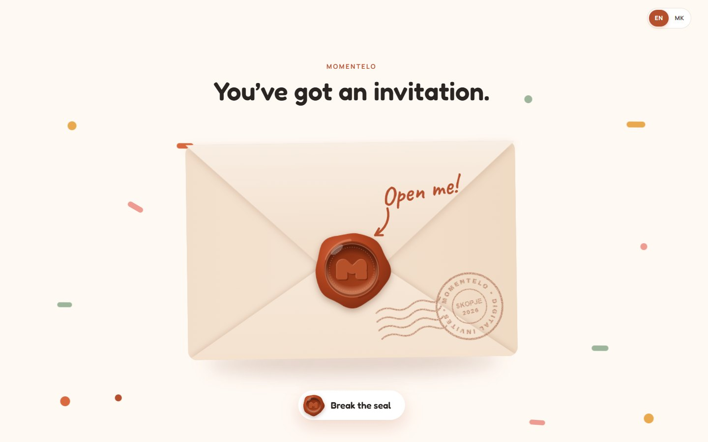
</p>

---

## What it is

Pokanito turns an invitation into a small, beautiful website. Each one lives at its own link, such as `pokanito.mk/ana-marko`. Guests open it on their phone, watch the countdown tick, read the program, find the venue in one tap and RSVP. Every reply lands straight in the host's inbox.

There's nothing to install and nothing to print, and the host never has to log in anywhere:

1. **Choose a template.** The host browses the gallery and taps any design to open its live demo.
2. **Tell us about it.** They send names, date, venue and photos through the contact form.
3. **We personalize it.** The Pokanito team builds their version in the admin and sends a preview link.
4. **It goes live.** The invitation is published at its own link, ready to share.

<p align="center">
  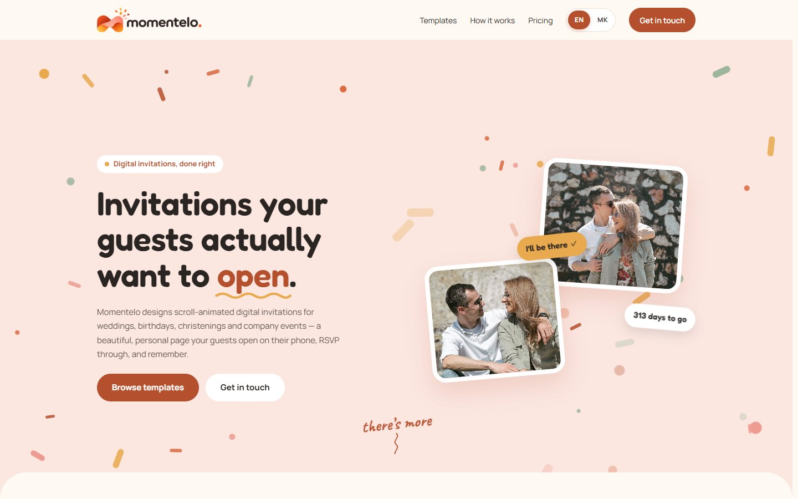
</p>

## Inside every invitation

| | |
| --- | --- |
| **Live countdown** | Ticks down every time a guest reopens the link. |
| **RSVP in a tap** | Guest count and menu choice, emailed straight to the host. |
| **One-tap directions** | Church, venue and parking, right in the guest's maps app. |
| **Macedonian or English** | Or both, with a language switch for guests abroad. |
| **Photos and music** | Photo slots with focal points, plus optional background music. |
| **Private if needed** | An optional access code keeps an invitation for invited guests only. |

<p align="center">
  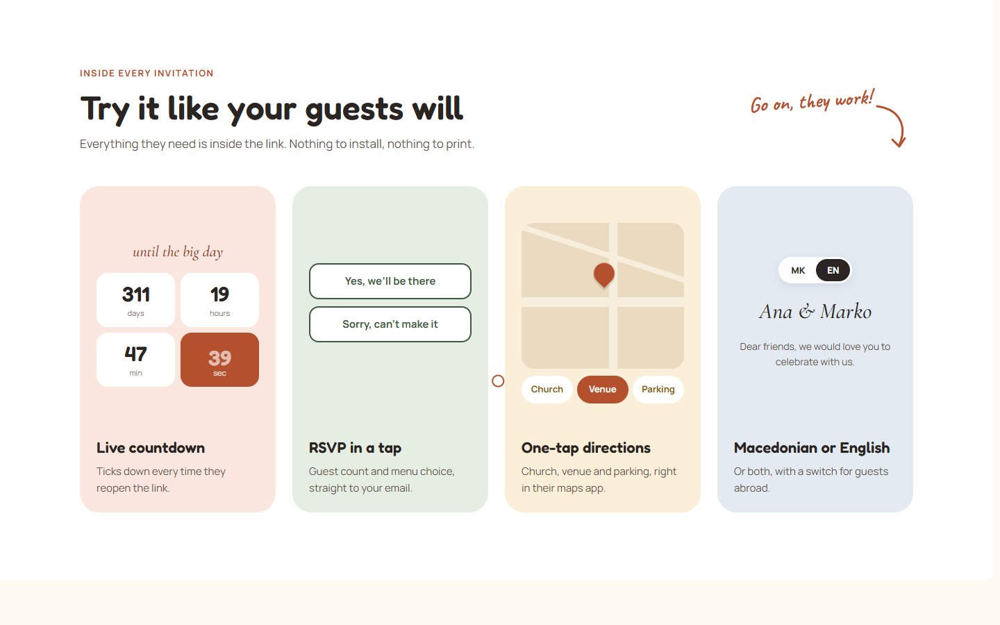
</p>

## Templates

Every template is a real, working invitation, built mobile-first and animated as you scroll.

<p align="center">
  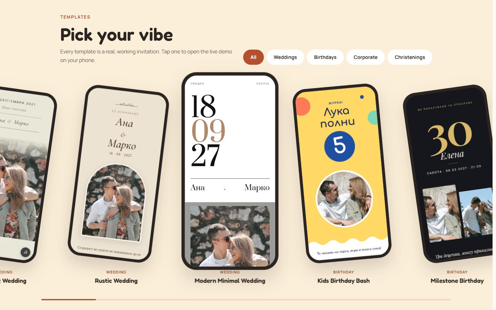
</p>

<p align="center">
  
  &nbsp;
  
  &nbsp;
  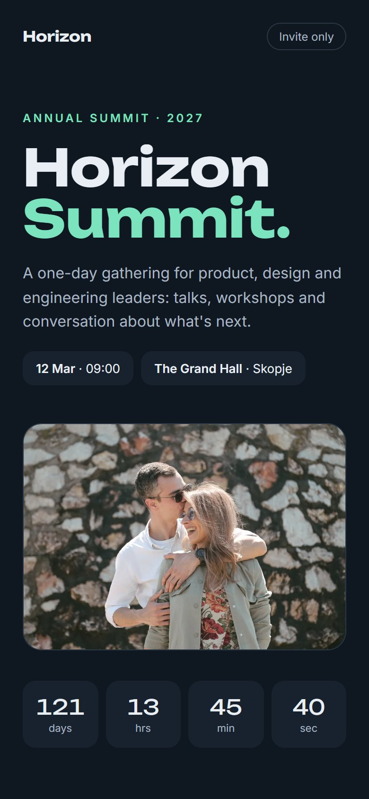
</p>
<p align="center"><sub>Kids Birthday Bash · Milestone Birthday · Conference &amp; Summit</sub></p>

## The admin

The team runs everything from one workspace: events, templates, leads, media and settings. Its editor shows the real invitation in a live phone or desktop preview while you type.

<p align="center">
  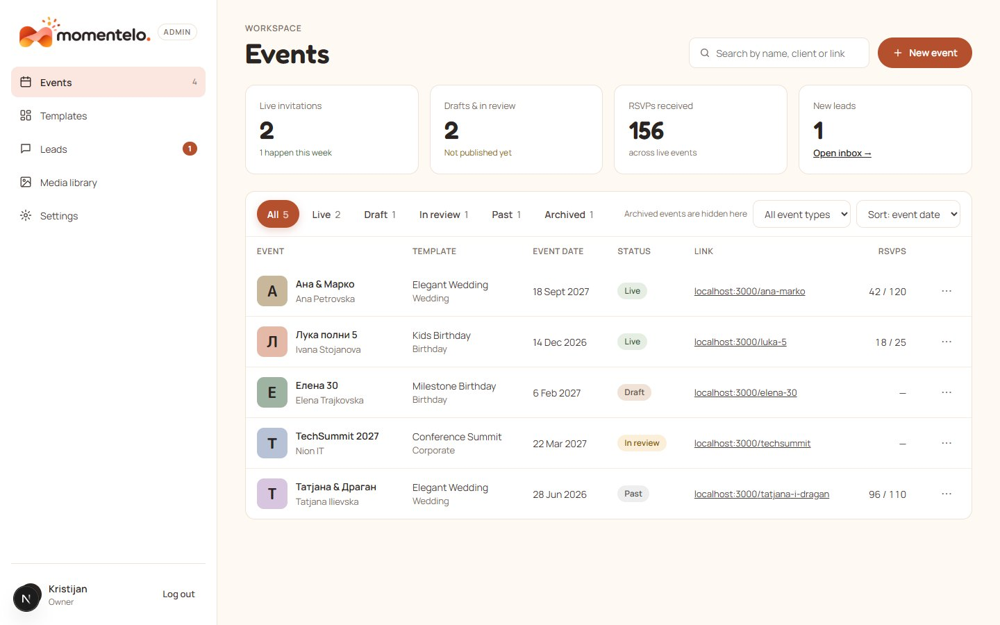
</p>

<table>
  <tr>
    <td width="50%">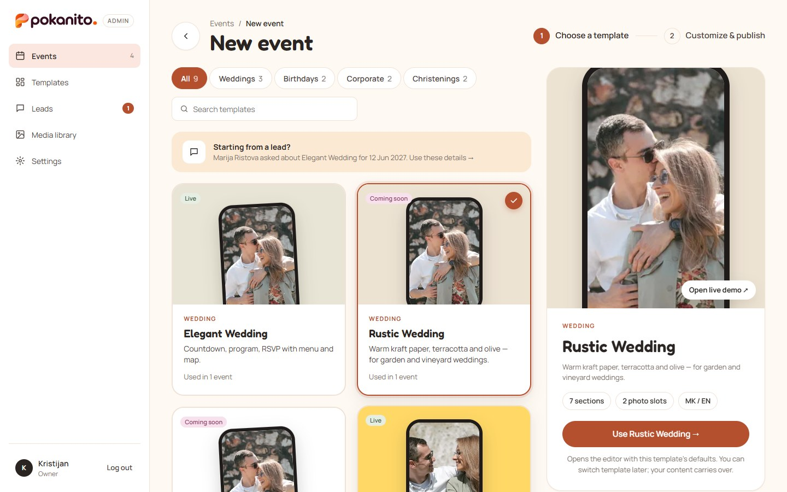</td>
    <td width="50%">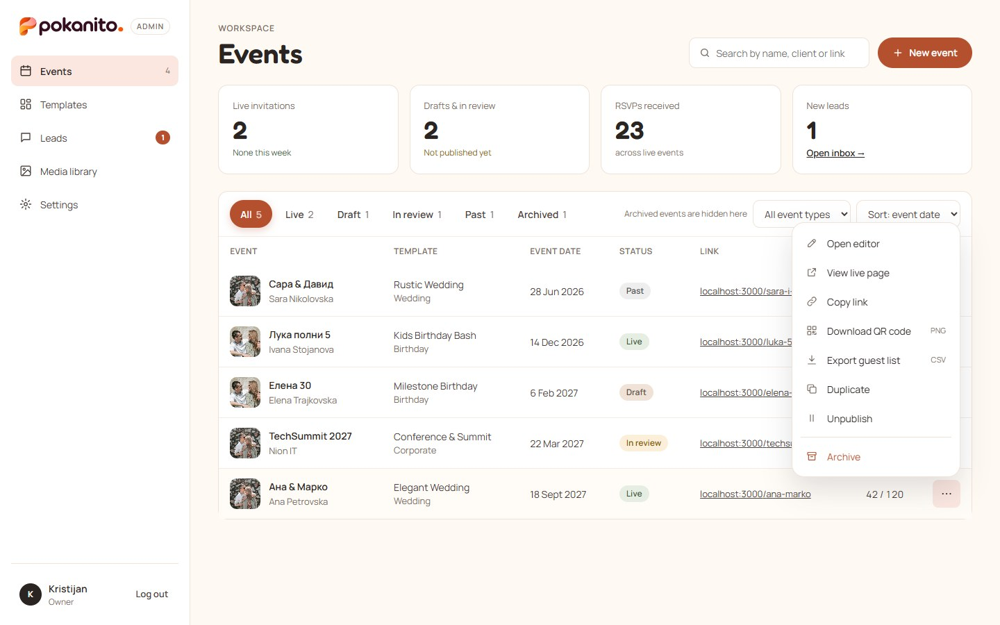</td>
  </tr>
  <tr>
    <td><sub><strong>New event.</strong> Pick a template, or start from a lead's request.</sub></td>
    <td><sub><strong>Row actions.</strong> Share links, QR codes and guest-list exports.</sub></td>
  </tr>
  <tr>
    <td>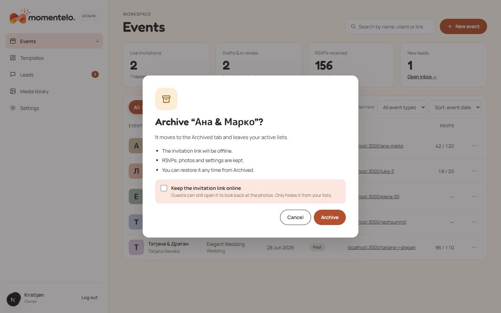</td>
    <td>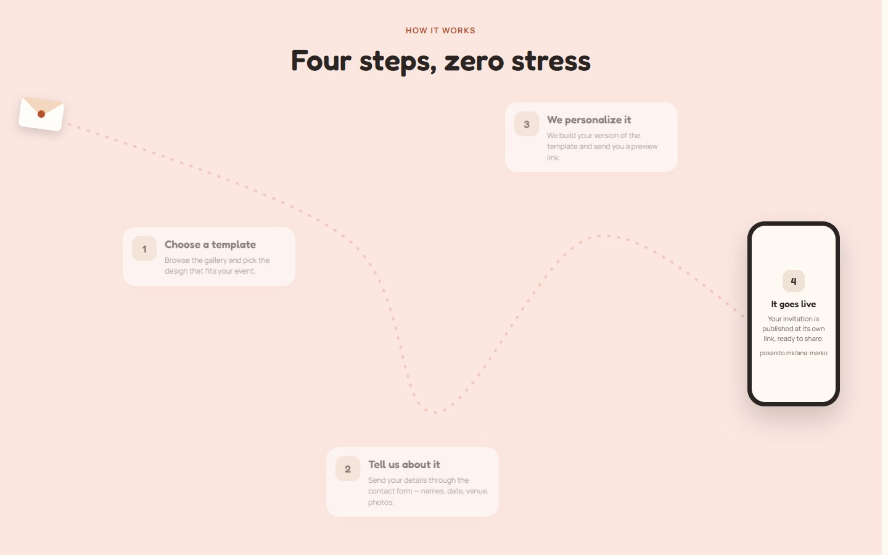</td>
  </tr>
  <tr>
    <td><sub><strong>Archive.</strong> Optionally keep the invitation link online.</sub></td>
    <td><sub><strong>How it works.</strong> The landing page's scroll-driven journey.</sub></td>
  </tr>
  <tr>
    <td colspan="2">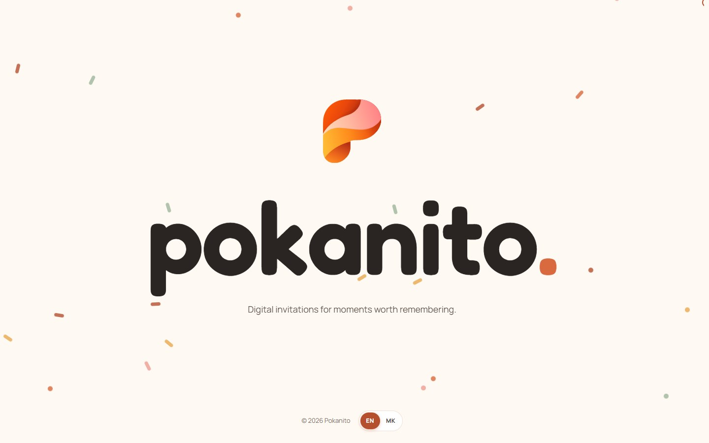</td>
  </tr>
  <tr>
    <td colspan="2"><sub><strong>Finale.</strong> The landing page signs off with the mark and the wordmark spelled out letter by letter.</sub></td>
  </tr>
</table>

## Brand

| | |
| --- | --- |
| **Voice** | Warm, personal, a little playful. Short sentences, no jargon. |
| **Logo** | The folded-paper **P** mark plus the lowercase `pokanito` wordmark with a tangerine dot. The site and admin use `pokanito-lockup.svg`, where the P is scaled to the letters' height and the box is cropped so the word centres on nav text; the designer's original lockup (`pokanito-logo.svg`, larger P) stays in the kit. Use the `-on-dark` versions on plum/dark backgrounds and the mono versions where gradients can't be used. Keep clear space of at least the height of the "o"; minimum 96 px wide for the logo, 16 px for the P alone. Don't recolour, stretch, rotate or add shadows. |
| **Brand colours** | Plum ink `#350F1F` · tangerine `#FF5606` · flame `#E8460C` · ember `#B92E10` · coral pink `#FF8486` · peach `#FFD9B8` · sunshine `#FFBA34` · blush cream `#FDF0EB`. |
| **UI colours** | The site and admin still use the terracotta palette: terracotta `#B5502F` · linen `#FBE6E0` · cream `#FFF9F3` · honey `#FCEFD9` · ink `#2A2522`, with sage and marigold accents. Tokens live in [`packages/ui/src/styles/_tokens.scss`](packages/ui/src/styles/_tokens.scss). |
| **Assets** | Source files (SVG logo, mark and wordmark in colour, on-dark and mono; app icons; wax seal; seal crack; favicons; PNG exports and the 1200×630 link-preview image) and the full brand guide are in [`packages/ui/brand/`](packages/ui/brand/). Each app serves what it uses from its own `public/brand/`; the `<Wordmark />` component in `@pokanito/ui` renders them (`variant="logo" \| "wordmark" \| "icon"`, `tone="dark"`). |
| **Name** | "Pokanito", capitalised in sentences; lowercase only inside the logo. |
| **Languages** | Macedonian (default) and English across the landing page and invitations. |

---

# For developers

## Architecture

npm-workspaces monorepo:

```
apps/
  web/     Next.js (Pages Router): landing "/", invitations "/<slug>", previews, OG images      :3000
  admin/   Next.js (Pages Router): team admin, served at <site>/admin (events, editor, …)       :3001
  api/     Hono + Prisma: REST API, email queue, media processing, background jobs             :4000
packages/
  ui/         @pokanito/ui: design system (tokens + React components) shared by landing and admin
  templates/  @pokanito/templates: template engine + the 9 invitation templates
  shared/     @pokanito/shared: domain constants, content model, zod schemas, API types, date helpers
```

```
 guest ─► web ──/api/public/*──┐                     ┌─► Resend (RSVP / test / lead / invite emails)
 team  ─► admin ─/api/*────────┼─► api ─► database ──┤
          web ◄─/api/revalidate┘    └─► storage      └─► jobs: email retries, daily digest, live→past
          admin ⇄ web /preview iframe (postMessage live preview)
```

- **One address.** The public site shows the admin at `/admin` (a Next.js rewrite to the admin app, which has `basePath: "/admin"`) and proxies `/api/public/*` and `/api/admin/*` to the API. Everything is same-origin: no CORS, and the session cookie is first-party.
- **Static invitations.** Invitations are statically generated per slug (ISR). The API asks the site to revalidate the affected pages whenever something is published or edited.
- **Live preview.** The editor's preview is the real template, rendered by the public site in an iframe (`/preview/<id>?token=…&embed=1`). The admin pushes unsaved changes into it with `postMessage` (`pokanito:preview` ⇄ `pokanito:preview-ready`), and only messages from `NEXT_PUBLIC_ADMIN_URL` are accepted.

## The template engine (`packages/templates`)

Each template is reusable code plus per-event content:

```
src/engine/            runtime (useInvitation), hooks (countdown, reveal, parallax, music),
                       useRsvpForm (5 RSVP modes) + RSVP parts (rsvp.tsx), TemplateShell,
                       Photo/Map/LanguageToggle/MusicButton/CountdownUnits, sections, checklist
src/<template>/        definition.ts (React-free) + Template.tsx + Template.module.scss,
                       index.ts (definitions + Component), optional copy.ts / ornaments.tsx
styles/_mixins.scss    SCSS mixins shared by the template modules
src/definitions.ts     React-free registry (`designs`), used by the API and the admin
src/index.tsx          design → component map + <Invitation event submitRsvp />
```

- An **Event** stores `templateId`, `content` (one shared content model, `packages/shared/src/content.ts`, with guest text per locale `{ mk, en }`), `theme` (colour levers with preset swatches), and `sections` (order plus on/off).
- A **definition** declares the template's sections (with editor labels such as "Agenda" or "What awaits"), photo slots (aspect, required), theme options, RSVP mode, fonts, default content (with `[Placeholders]`) and demo data.
- **Templates:**

  | id | Live on landing |
  | --- | --- |
  | elegant-wedding (the original) | ✓ |
  | rustic-wedding · minimal-wedding | coming soon |
  | kids-birthday | ✓ |
  | milestone-birthday | coming soon |
  | conference-summit | ✓ |
  | product-launch (same component as conference-summit) | coming soon |
  | classic-christening | ✓ |
  | floral-christening (same component as classic-christening) | coming soon |

- **Publish checklist** (`getPublishChecklist`, shared by the editor and the API's publish gate). It requires:
  - names, date and time
  - every required photo slot filled
  - an RSVP deadline
  - an RSVP email that has been set and tested
  - no `[placeholder]` text left
  - the client's approval
- **Motion and accessibility.** Scroll reveal, subtle parallax and a live countdown all respect `prefers-reduced-motion`. Dates always render in Europe/Skopje time. Macedonian month and day names are built in, because Chrome's ICU has no Macedonian.

### Template variants and defaults (no code)

- **Templates › New template** creates a *variant*: it reuses an existing layout (`Template.layoutId`) with its own name, category, card thumbnail, status, palette, sections and default text. Its demo starts as a copy of the base demo.
- **Edit defaults** opens the normal event editor on the template's hidden defaults event (`Event.isDefaults`). Every new event of that template starts as a copy of it. Defaults events are never listed, published or reachable by URL.
- The palette swatches and the section chips in the Templates side panel edit those same defaults.
- An event keeps `templateId` = its layout (what renders), and `variantId` = the variant it came from (for names and usage counts).
- Variants can be deleted while no events use them. Built-in templates can only be hidden.

### Adding a template (new layout, needs code)

1. Create `packages/templates/src/<id>/` with `definition.ts`, `Template.tsx`, `Template.module.scss` and `index.ts`. Copy the closest existing template; compose it from the engine (`TemplateShell`, `RsvpSection` and friends, `useCountdown().units`).
2. Add its folder to `designs` in `src/definitions.ts`; the typecheck then asks for its component in `src/index.tsx`. (A second catalog entry for an existing component only goes into that folder's `definitions` list.)
3. Add a catalog row to `CATALOG` in `apps/api/prisma/seed.ts`, then run `npm run db:seed`. This creates `/demo-<id>`.
4. Set its status (Live / Coming soon / Hidden) in Admin › Templates.

## Getting started

Requires Node ≥ 20.12.

```bash
npm install
cp apps/api/.env.example apps/api/.env
cp apps/web/.env.example apps/web/.env.local
cp apps/admin/.env.example apps/admin/.env.local
npm run setup        # migrate + seed: owner account, settings, catalog, template demos
npm run dev          # api :4000 · web :3000 · admin :3001
```

Sign in at http://localhost:3000/admin with `ADMIN_EMAIL` / `ADMIN_PASSWORD` from `apps/api/.env`.

Without `RESEND_API_KEY`, emails are printed in the API console. The full flow (test email, RSVP email, invites) still works locally.

If you see "Prisma Client did not initialize", run `npm run postinstall -w @pokanito/api`. npm ≥ 11 may skip dependency install scripts.

| Script | |
| --- | --- |
| `npm run dev` | All three apps in watch mode |
| `npm run build` | Production build of api → web → admin (web prerenders from a running API) |
| `npm run typecheck` / `npm run lint` | tsc in every workspace / ESLint across the repo |
| `npm run db:migrate` / `db:seed` / `db:studio` | Prisma migrate (dev) / idempotent seed / DB browser |

## Key flows

- **RSVP.**
  1. A guest submits the form. The API rate-limits it, validates it and checks the honeypot.
  2. The RSVP is stored and queued for email.
  3. The API emails each address in the event's RSVP list, plus the owner if "Send me a copy" is on. Retries back off over roughly an hour, and failures show in the editor's Replies pane with a Resend button.
  4. With "Daily summary for clients" on, clients get one digest a day (after `DIGEST_HOUR`) instead of one email per reply.
  5. Past the deadline, the form shows a closed message.
  6. Demo invitations accept RSVPs but don't store them.
- **Publish.**
  1. The checklist must pass.
  2. The status becomes Live, and `expiresAt` is set to the event date plus "keep online" months.
  3. The page is revalidated.
  4. The day after the event, a job moves it to Past. After `expiresAt`, guests see a gentle "this invitation has ended" page.
- **Previews.** "Share preview link" produces `/<slug>?preview=<token>`. It works for drafts, lasts 14 days, and moves a draft to In review.
- **Lead → event.** The contact form and "Notify me" create leads.
  1. "Create event from lead" prefills the client, template and date, and links the lead, which moves the lead to Won.
  2. Publishing the event moves the lead to Live.
- **Password-protected invitations.** An optional access code per event. Guests type it once per session. The default comes from Settings.
- **Media.**
  - Upload JPG, PNG, HEIC (converted) or MP3. Originals are kept, and 640/1080/1600px WebP versions are generated.
  - Every photo has a focal point.
  - "Used in" and "Unused" are tracked from event content, and deleting a file that's in use asks first.
  - Storage is local in dev and S3-compatible (e.g. Cloudflare R2) in production; see `apps/api/.env.example`.
- **Team.** The users table is the allow-list. Owners invite people by email (the invite link is also shown, in case email isn't set up) and assign the Owner or Editor role.

## Environment

| App | File | Variables |
| --- | --- | --- |
| api | `apps/api/.env` | `DATABASE_URL`, `AUTH_SECRET`, `WEB_URL`, `ADMIN_URL`, `REVALIDATE_SECRET`, `ADMIN_EMAIL`/`ADMIN_PASSWORD`/`ADMIN_NAME` (seed), `RESEND_API_KEY`, `MEDIA_DRIVER` + `S3_*`/`MEDIA_PUBLIC_URL`, `MEDIA_QUOTA_GB`, `DIGEST_HOUR` |
| web | `apps/web/.env.local` | `API_URL`, `REVALIDATE_SECRET`, `NEXT_PUBLIC_SITE_URL`, `NEXT_PUBLIC_ADMIN_URL` (e.g. `https://pokanito.mk/admin`), `ADMIN_APP_URL` (where the admin app runs) |
| admin | `apps/admin/.env.local` | `API_URL`, `NEXT_PUBLIC_WEB_URL` |

## Deploying

- **API:** `npm run build -w @pokanito/api && npm run db:deploy -w @pokanito/api && npm run start -w @pokanito/api`.
  - For production, switch `provider` in `schema.prisma` to `postgresql`, set `DATABASE_URL`, and generate a fresh migration.
  - Use `MEDIA_DRIVER=s3` (R2).
  - Run a single instance (jobs and rate limits are in-process), or set `JOBS=off` on extra instances.
- **web (Netlify):** the main site, configured by [`netlify.toml`](netlify.toml) at the root. Set `API_URL`, `REVALIDATE_SECRET`, `NEXT_PUBLIC_SITE_URL`, `NEXT_PUBLIC_ADMIN_URL=<site>/admin` and `ADMIN_APP_URL`.
- **admin (second Netlify site):** same repo, Base directory empty, Package directory `apps/admin` (uses [`apps/admin/netlify.toml`](apps/admin/netlify.toml)). Set `API_URL` and `NEXT_PUBLIC_WEB_URL`. Put its Netlify URL in the main site's `ADMIN_APP_URL`; people use it at `<site>/admin`.
- **API:** set `WEB_URL=<site>` and `ADMIN_URL=<site>/admin` (links in emails).
- **Email:** verify the sending domain (e.g. `pokanito.mk` for `rsvp@pokanito.mk`) in Resend.

## Owner TODOs (placeholders kept on purpose)

- `[PRICE]` and `[N]` on the landing page: `apps/web/src/content/landing.ts`.
- Template default content contains `[Venue]`, `[COMPANY]`, `[Name]`. The publish checklist blocks any event that still has them.
- Answers to the handoff's open questions (§12): prices, delivery time, how long invitations stay online (Settings › Links & publishing), email domain, payments, music sourcing.
